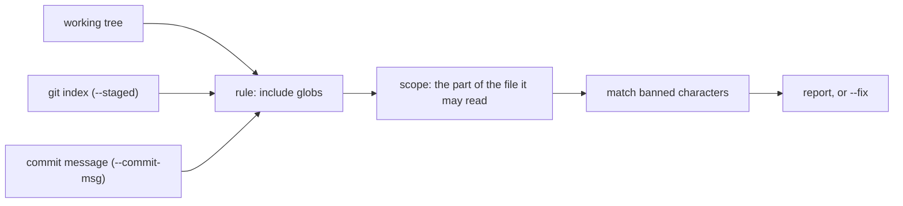

<div align="center">

# charcheck

Ban a character once, check it in code, prose, components and commit messages.

[![npm][npm-badge]][npm]
[![CI][ci-badge]][ci]
[![Node][node-badge]][node]
[![License][license-badge]][license]

---

<a href="#install"><kbd>&nbsp;<br>&nbsp;&nbsp;Install&nbsp;&nbsp;<br>&nbsp;</kbd></a>
<a href="#quickstart"><kbd>&nbsp;<br>&nbsp;&nbsp;Quickstart&nbsp;&nbsp;<br>&nbsp;</kbd></a>
<a href="#how-it-works"><kbd>&nbsp;<br>&nbsp;&nbsp;How it works&nbsp;&nbsp;<br>&nbsp;</kbd></a>
<a href="docs/README.md"><kbd>&nbsp;<br>&nbsp;&nbsp;Docs&nbsp;&nbsp;<br>&nbsp;</kbd></a>

---

</div>


charcheck flags banned characters, like em dashes and zero width spaces, in the parts of a
repo you point it at.
One config drives the package script, the pre-commit hook and the commit-msg hook.
Each rule picks which files it reads and which part of each file it may match inside.

- Scopes that read only string literals, only comments, only Markdown prose, or only the
  rendered text of a Vue or HTML file.
- `--staged` reads the git index, so unstaged edits never fail a commit.
- `--commit-msg` checks the message itself, skipping comment lines and the scissors.
- `--fix` rewrites what a rule knows how to replace and reports the rest.
- A baseline file, so a repo that is not at zero can still go green.
- Pretty, JSON and SARIF output.

## Why this project?

Each existing tool sees one surface.
ESLint plugins see the JavaScript AST, prose linters see Markdown, and nothing checks commit
messages.
Banning one character across a repo used to mean three tools, three configs, and a gap
where the commit message goes.

| Tool                                                                                                | Reads                                        | Pick it when                                                  |
| --------------------------------------------------------------------------------------------------- | -------------------------------------------- | ------------------------------------------------------------- |
| charcheck                                                                                           | Code, comments, Markdown, Vue, HTML, commits | One character list should hold everywhere, per-surface policy |
| [eslint-plugin-em-dash-checker](https://www.npmjs.com/package/eslint-plugin-em-dash-checker)        | JavaScript string literals                   | Your text lives only in code and you already run ESLint       |
| [textlint](https://textlint.github.io/) + [prh](https://github.com/textlint-rule/textlint-rule-prh) | Prose files                                  | You want natural language rules, not just characters          |
| [Vale](https://vale.sh/)                                                                            | Prose, with real style guides                | You want an editorial style guide enforced                    |
| [slop-lint](https://www.npmjs.com/package/slop-lint)                                                | Vocabulary and characters                    | You want opinions about words too                             |

charcheck has no word lists and won't get any.
It is about characters.

## Install

Requires Node 24 or newer, which loads a `charcheck.config.ts` with no bundler or loader.

```bash
pnpm add -D charcheck
```

Scopes other than `raw` need a parser installed beside it, listed in
[How it works](#how-it-works).

## Quickstart

1. Write `charcheck.config.js` at the repo root.
   This one bans em dashes everywhere, with a different policy for each surface:

   ```js
   const DASH = '—';

   export default {
     rules: [
       { id: 'prose', chars: [DASH], fix: ',', scope: 'markdown', include: ['**/*.md'] },
       { id: 'code', chars: [DASH], scope: 'strings', include: ['src/**/*.ts'] },
       { id: 'pages', chars: [DASH], scope: 'markup', include: ['src/**/*.vue'] },
       { id: 'commits', chars: [DASH], include: ['<commit-msg>'] },
     ],
   };
   ```

   Comments in `src/` stay free to use the dash, because the `strings` scope never reads
   them.

2. Add a script and run it:

   ```json
   { "scripts": { "lint:chars": "charcheck" } }
   ```

   ```bash
   pnpm run lint:chars
   ```

3. Rewrite what the rules can fix, then read the diff:

   ```bash
   pnpm run lint:chars --fix
   ```

4. Call it from your git hooks.
   The pre-commit hook runs `charcheck --staged` and the commit-msg hook runs
   `charcheck --commit-msg "$1"`.
   [Getting started](docs/getting-started.md) has the setup for lefthook, husky, plain
   `.git/hooks` and CI.

## How it works



A rule's `scope` decides which part of a file it may match inside.
A wrong scope fails silently, because a scan that reads nothing looks like a scan that
passed.

| Scope           | Reads                                                  | Applies to             | Needs                             |
| --------------- | ------------------------------------------------------ | ---------------------- | --------------------------------- |
| `raw` (default) | The whole file                                         | Any file               | Nothing                           |
| `strings`       | String and template literals, never comments           | JavaScript, TypeScript | `typescript`                      |
| `comments`      | Line and block comments, never literals or code        | JavaScript, TypeScript | `typescript`                      |
| `markup`        | Template text, allowlisted attributes, script blocks   | `.vue`                 | `@vue/compiler-sfc`, `typescript` |
| `markdown`      | Prose, never fenced or inline code, never link targets | `.md`, `.markdown`     | `micromark`                       |
| `html`          | Page text, allowlisted attributes, script literals     | `.html`, `.htm`        | `parse5`, `typescript`            |

Every parser is an optional peer dependency, imported only when a rule uses its scope.
A repo using only `raw` installs nothing extra.
TypeScript 5, 6 and 7 all work, except that 7 can't read JSX.
[Scopes](docs/scopes.md) has the details.

## For agents

An agent that hits a charcheck bug sees a pass, not an error, and tends to paper over it
with an `exclude` glob.
The package ships a `charcheck-upstream` skill that teaches it to triage the miss and file a
real report:

```bash
npx skills add ./node_modules/charcheck -s '*' -a claude-code -a codex -a universal -y
```

[Agent skill](docs/agent-skill.md) covers updating it and what `--report-issue` prints.

## More

- [Getting started](docs/getting-started.md): scripts, hook managers and CI
- [Scopes](docs/scopes.md): which part of a file a rule should read
- [Configuration](docs/configuration.md): rules, fixes and suppression comments
- [Command line](docs/cli.md): every flag and exit code
- [Baseline](docs/baseline.md): adopting charcheck in a repo that is not at zero
- [Programmatic API](docs/api.md): calling `scan` from a script or a test
- [Presets](docs/presets.md): ready-made character lists
- [Limitations](docs/limitations.md): what is not caught, on purpose or not yet
- [Contributing](CONTRIBUTING.md) and [issues](https://github.com/shbernal/charcheck/issues)

[npm]: https://www.npmjs.com/package/charcheck
[npm-badge]: https://img.shields.io/npm/v/charcheck?style=for-the-badge&logo=data:image/svg%2bxml;base64,PHN2ZyB4bWxucz0iaHR0cDovL3d3dy53My5vcmcvMjAwMC9zdmciIHZpZXdCb3g9IjAgMCAyNCAyNCI+PHJlY3Qgd2lkdGg9IjI0IiBoZWlnaHQ9IjI0IiByeD0iMS44IiBmaWxsPSIjQ0IzODM3Ii8+PHBhdGggZmlsbD0iI2ZmZiIgZD0iTTUuMTMgNS4zMjNsMTMuODM3LjAxOS0uMDA5IDEzLjgzNmgtMy40NjRsLjAxLTEwLjM4MmgtMy40NTZMMTIuMDQgMTkuMTdINS4xMTN6Ii8+PC9zdmc+&color=CB3837&labelColor=1a1b26
[ci]: https://github.com/shbernal/charcheck/actions/workflows/ci.yml
[ci-badge]: https://img.shields.io/github/actions/workflow/status/shbernal/charcheck/ci.yml?branch=main&style=for-the-badge&logo=githubactions&logoColor=9ece6a&color=9ece6a&labelColor=1a1b26&label=CI
[node]: https://nodejs.org
[node-badge]: https://img.shields.io/badge/node-%E2%89%A5%2024-e0af68?style=for-the-badge&logo=nodedotjs&logoColor=e0af68&labelColor=1a1b26
[license]: LICENSE
[license-badge]: https://img.shields.io/github/license/shbernal/charcheck?style=for-the-badge&color=bb9af7&labelColor=1a1b26
